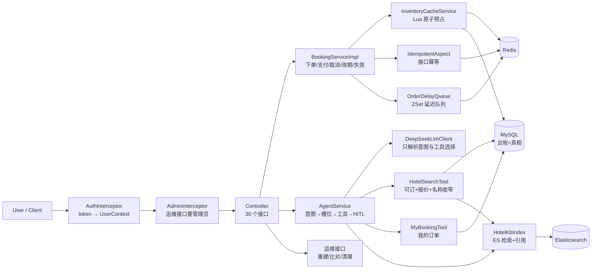
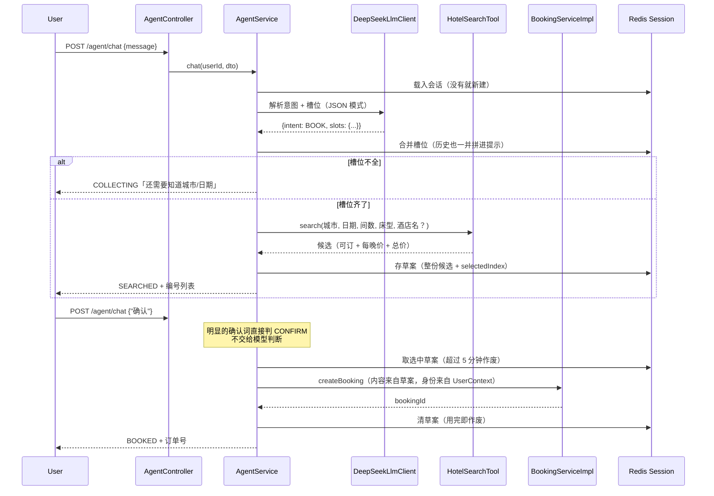

# hotel-booking

<div align="center">

**酒店预订场景的 Spring Boot 全栈实战：区间库存高并发 + Agent + RAG**

一套代码、两条学习主线 —— 逐日库存、条件 UPDATE、台账对账、Lua 原子预占、延迟队列、GEO、缓存三兄弟、幂等这些高并发考点全部长在真实业务上；同一套业务之上，再叠一层意图路由 + 工具编排 + HITL 确认 + RAG 问答。


</div>

## 项目简介

`hotel-booking` 是一个酒店预订业务系统 + 一个能真正办成事的预订 Agent。同一套代码上有**两条相互独立的学习主线**：

| 主线 | 能学到什么 | 入口 |
| --- | --- | --- |
| **区间库存与高并发** | 逐日库存建模、条件 UPDATE 唯一裁决、台账与零漂移对账、Lua 原子预占与事务补偿、ZSet 延迟队列、GEO 附近、缓存三兄弟、接口幂等、双实例并发正确性 | 下方 [区间库存实战](#区间库存实战)；逐考点的代码级文档在 [`docs/`](docs/)（6 篇，一个阶段一篇） |
| **Agent 与 RAG** | 意图路由、槽位多轮、工具编排（两种实现并做过 A/B）、订单 HITL 确认断点、RAG 引用溯源与拒答、三层评测体系 | 下方 [Agent 与 RAG 链路](#agent-与-rag-链路) |

两条主线不是硬拼在一起：**Redis 既是 Agent 的对话状态存储**（槽位、候选草案、待确认项），也是业务侧的高并发底座（库存缓存、锁、幂等、延迟队列）。所以读 Agent 链路时会反复撞见 Redis 的用法，反之亦然。

### 和常见"订房 Demo"的区别

**库存单元不是「房型」，而是「房型 × 日期区间」。**

打车系统里"一个城市有 N 辆车"是一个**数**；酒店不是：

```
房型 2001，总共 3 间
             11-19   11-20   11-21   11-22
sold_rooms     1       2       3       0      ← 每天一行，UNIQUE(room_type_id, stay_date)

11-20 住到 11-22 → 占 11-20、11-21 两天，11-22 那天是别人的
```

一个 2 晚的订单要**同时**在多行上成功；任何一行不够就整单失败、**一行都不能留**。改期、退订、对账全部建立在这个模型之上 —— 这也是本项目所有复杂度的源头。

## 亮点

**区间库存与高并发**

- **条件 UPDATE 是唯一裁决者**：「够不够」与「扣掉」在同一条 SQL 里，没有"先查再改"的窗口
- **台账是真相**：`booking_inventory_link` 记谁占了哪天几间；`sold_rooms` 与 Redis 缓存都是可重建的派生数据
- **Lua 原子预占 + 事务补偿**：缓存侧快速筛选，回滚时用 `afterCompletion` 补偿，DB 仍是最终裁决
- **ZSet 延迟队列双保险**：Lua 原子认领做多实例去重，扫表兜底防止队列丢任务
- **缓存三兄弟各有对策**：穿透（空值标记）/ 击穿（单飞 + 锁 + 比较后删除）/ 雪崩（TTL 加法抖动）
- **双实例并发验证过**：12 并发零重号、超时单只释放一次、会话跨实例共享

**Agent 与 RAG**

- **模型只做一件事**：把自然语言解析成 `{意图, 槽位}`。算价、查房、排序、总价全部由代码完成
- **工具编排做了两条路并实测对比**：确定性意图路由 vs function calling（结论见下方 A/B 一节）
- **订单 HITL**：下单前三道安全线 —— 内容只来自草案、身份只来自 `UserContext`、草案用完即作废
- **两处确定性兜底**：「确认」这类词不交给模型判断；日期被模型放错槽位时自动归一
- **RAG 带引用与拒答**：只依据检索到的原文作答，资料里没有就明说没查到
- **三层评测**：40 条 Agent 用例（意图/槽位/阶段）+ 15 条检索用例（recall@k）+ 377 项端到端断言

## 总体架构



## 区间库存实战

这里不是"把 Redis 命令挨个试一遍"，而是**每个考点都由一个真实的业务需求逼出来** —— 没有"用户手抖点两下会下两张单"的问题，就不会有幂等切面。

| 业务需求 | 技术点 | 用到的能力 | 代码落点 |
| --- | --- | --- | --- |
| 一个 2 晚订单要跨两天同时成功 | **逐日库存建模** | 每天一行 `UNIQUE(room_type_id, stay_date)`，左闭右开 `[checkIn, checkOut)` | [`schema.sql`](db/schema.sql) |
| 防止超卖 | **条件 UPDATE** | 判断与修改合并为一条 SQL，不靠"先查再改" | [`BookingServiceImpl`](src/main/java/com/fancy/hotel/service/impl/BookingServiceImpl.java) |
| 退订/改期后要能对账 | **台账** | `booking_inventory_link` 是唯一真相；`sold_rooms` 只是可重建的汇总 | [`BookingServiceImpl`](src/main/java/com/fancy/hotel/service/impl/BookingServiceImpl.java) |
| 缓存预占成功但事务回滚 | **事务补偿** | `TransactionSynchronization.afterCompletion` 里把 Redis 占位还回去 | [`BookingServiceImpl`](src/main/java/com/fancy/hotel/service/impl/BookingServiceImpl.java) |
| 库存行可能不存在，边建边扣 | **S→X 锁升级死锁** | `INSERT IGNORE` 留共享锁、后续 `UPDATE` 要排他锁 → 补建行必须挪出事务（`NOT_SUPPORTED`，且必须是独立 Bean） | [`InventoryRowPreparer`](src/main/java/com/fancy/hotel/service/InventoryRowPreparer.java) |
| 超时未支付要自动释放 | **ZSet 延迟队列** | `ZRANGEBYSCORE` + `ZREM` 用 Lua 做成原子认领，多实例天然去重；另有扫表兜底 | [`OrderDelayQueue`](src/main/java/com/fancy/hotel/service/OrderDelayQueue.java) |
| 附近酒店要按距离排序 | **GEO** | 单 key + `GEOSEARCH`；非距离排序时自动放大候选池 | [`HotelGeoIndex`](src/main/java/com/fancy/hotel/service/HotelGeoIndex.java) |
| 反复查一个不存在的房型 | **缓存穿透** | 空值标记（tombstone 60 秒），只缓存"确实不存在" | [`AbsentCache`](src/main/java/com/fancy/hotel/service/AbsentCache.java) |
| 热点日期的库存被并发回源 | **缓存击穿** | 单飞 + 分布式锁 + Lua 比较后删除（不误删别人的锁） | [`InventoryCacheService`](src/main/java/com/fancy/hotel/service/InventoryCacheService.java) / [`DistributedLock`](src/main/java/com/fancy/hotel/service/DistributedLock.java) |
| 同一批缓存 key 同时过期 | **缓存雪崩** | TTL 加法抖动：`base + random(0, jitter)` | [`InventoryCacheService`](src/main/java/com/fancy/hotel/service/InventoryCacheService.java) |
| 改价后报价必须立刻变 | **价格缓存失效** | 按月 Hash 缓存 + 改价时删 key（不是更新 key） | [`PriceCacheService`](src/main/java/com/fancy/hotel/service/PriceCacheService.java) |
| 用户手抖点两下会下两张单 | **接口幂等** | `@Idempotent` AOP（在事务之外）+ `SET NX EX` + 结果回放；**指纹里含登录用户** | [`IdempotentAspect`](src/main/java/com/fancy/hotel/config/IdempotentAspect.java) |
| 有人拿别人的订单号来操作 | **越权校验** | 归属校验下沉到唯一入口 `requireBooking`，越权统一 403 且零副作用 | [`BookingServiceImpl`](src/main/java/com/fancy/hotel/service/impl/BookingServiceImpl.java) |
| 两个实例同时跑定时任务 | **多实例去重** | 认领靠 Redis 里的条件操作（Lua / 条件 UPDATE），不靠本地状态 | [`OrderDelayQueue`](src/main/java/com/fancy/hotel/service/OrderDelayQueue.java) / [`OrderTimeoutJob`](src/main/java/com/fancy/hotel/job/OrderTimeoutJob.java) |

### 代码组织上的几个约定

- **4 个 Lua 脚本集中在** [`RedisScripts`](src/main/java/com/fancy/hotel/config/RedisScripts.java)，每个脚本的注释都写明了它要解决的是哪个竞态（[`lua/`](src/main/resources/lua/)）。
- **所有 key 集中在** [`RedisKeyConstants`](src/main/java/com/fancy/hotel/common/RedisKeyConstants.java)，不在业务代码里就地拼字符串。
- **缓存只做加速，绝不做正确性依赖**：Redis 预占只是快速筛选，条件 UPDATE 才是唯一裁决；**Redis 不可用时业务降级而不是报错**（这条是踩过坑之后才补上的，见下方 bug 清单第 2 条）。
- **状态码 90 / 91 拆开**：`90 CANCELLED`（用户取消，按退订政策扣费）与 `91 EXPIRED`（超时失效，全额退）—— 合成一个"已取消"会让退款口径和统计全部含糊。

## Agent 与 RAG 链路

### 1. 主链路

仓库里的主入口是 [`AgentService`](src/main/java/com/fancy/hotel/service/agent/AgentService.java)：

1. `AgentController` 接收 `POST /agent/chat`，身份来自 token 而不是请求体
2. `AgentService` 从 Redis 载入会话（或新建），把**最近几轮对话 + 已知槽位 + 本轮输入**拼成提示
3. 模型返回 `{意图, 槽位}`；服务端做二次校验（过去日期、离店≤入住、坏 JSON）
4. 槽位不全就追问；齐了就调工具查可订 + 报价
5. 查到结果**整份存进会话作为草案**，回复里列编号
6. 用户说"确认"才真正下单；下单内容只来自草案

### 2. 意图与工具

当前代码支持的意图：

| 意图 | 含义 | 会做什么 |
| --- | --- | --- |
| `BOOK` | 要订房 | 查可订 + 报价，出候选草案 |
| `QUERY` | 只是问问 | 同上，但不进入下单语义 |
| `MYBOOKINGS` | 我的订单 | 列出待支付/已确认的订单 |
| `CANCEL` | 取消订单 | 解析目标订单 → 出取消草案 → 等确认 |
| `RESCHEDULE` | 改期 | 解析订单 + 新日期 → 出改期草案 → 等确认 |
| `FACILITY` | 设施/政策问答 | 走 RAG 检索，带引用作答 |
| `CONFIRM` | 确认 | 按草案类型执行（订 / 取消 / 改期） |
| `CHITCHAT` | 闲聊 | 引导回业务 |

工具只有两个，但都很实：[`HotelSearchTool`](src/main/java/com/fancy/hotel/service/agent/HotelSearchTool.java)（可按酒店名收窄）、[`MyBookingTool`](src/main/java/com/fancy/hotel/service/agent/MyBookingTool.java)。

### 3. HITL：为什么"模型不能直接下单"



这条链路里有几个关键点：

- **槽位不是只存在 Prompt 里**，而是显式写进 Redis 会话，可跨实例、可重启
- **候选不是只回给前端**，而是整份存进会话 —— 用户说"第二个"真的能选中第二个
- **下单内容只来自草案**，不来自用户这句话、也不来自模型；否则"订那个 100 块的"就能把订单引走
- **身份只来自 `UserContext`**，模型永远不参与
- **确认词有确定性兜底**：上文全在聊"取消"时，模型会把"确认"也判成 CANCEL，导致死循环 —— 这个坑实测踩到过

### 4. RAG 链路

[`HotelKbIndex`](src/main/java/com/fancy/hotel/service/HotelKbIndex.java) 承担检索，数据流是：

```
hotel_kb_doc（MySQL，42 份原文）      ← 真相
        ↓ POST /booking/hotel/kb/rebuild
hotel_kb_v1（ES 索引：正文 + 酒店名）
        ↓ 检索（ngram + fuzziness + highlight）
模型（只依据检索到的原文作答，没有就说没有）
```

几个刻意的设计：

- **按"小节"切块**，不按字数硬切 —— 引用要说得清"依据：XX 酒店 · 停车场"
- **不装 IK，用 ES 内置 ngram**：容器内拉 GitHub 装 IK 超时，改用内置 ngram 后实测三件事都正常（正文检索 / 引用高亮 / 错别字 fuzziness）
- **拒答交给模型判断，不靠分数阈值**：一开始想用"相关度低于 2.5 就丢掉"，实测不可靠 —— ngram 几乎总能召回含共同二字切片的段落。改成 grounded generation，让模型判断"这份资料够不够回答"
- **酒店名支持错别字**：`fuzziness=AUTO`，"西部国宾馆"能匹配到"杭州西湖国宾馆"（分数 3.24），并有分数阈值兜住不乱认

## ★ 两种工具编排的实测对比

Agent 的工具编排实现了两条路，用同一批 handler、同一个评测集跑出来的真实数据：

| 指标 | 确定性路由（保留） | function calling |
| --- | --- | --- |
| 意图准确率 | **39/39 = 100%** | 31/39 = 79.5% |
| 槽位字段准确率 | 87/87 = 100% | 87/87 = 100% |
| 阶段准确率 | 31/32 = 96.9% | 29/32 = 90.6% |
| **端到端通过** | **38/39 = 97.4%** | 28/39 = 71.8% |
| 延迟 p50 | **1.67s** | 2.56s |

**结论和直觉相反**：function calling 更差。

原因是两个工具（查可订 / 出候选）**参数完全一样、只有意图不同**，模型倾向于选更"安全"的只读那个，于是"我要订房"被判成了查询。

而**槽位准确率两边都是 100%** —— 说明瓶颈在**工具选择**，不在参数抽取。把意图区分交给"工具名"去表达，本身就是个设计错误。

所以主路径保留确定性路由，function calling 作为扩展机制留着。复现：

```bash
./test/p4_agent_eval.ps1              # 确定性路由
./test/p4_agent_eval.ps1 -Mode tools  # function calling
```

## 评测体系

端到端测试只回答"这条流程还通不通"，回答不了"判断准不准"。所以另外做了两层评测：

| 层 | 规模 | 指标 | 现状 |
| --- | --- | --- | --- |
| **Agent 评测** | 40 条用例 × 3 层指标（意图 / 槽位 / 阶段） | 端到端 97.5% | 用它定位并修掉 3 类模型误判 |
| **检索评测** | 15 条标注（问题 → 正确小节） | recall@3 从 60% → 73.3% → 100% | **100% 已标注过拟合**，需 held-out 验收 |
| **端到端** | 14 个门禁套件 301 项 + 2 个 Agent 演示套件 66 项 + 双实例 10 项 | 全绿 | 门禁套件是提交前的硬门槛 |

检索的 60% → 73.3% 是**两个零成本修复**换来的：撤掉一个"既当排序又当裁决"的分数阈值、修一个 `keyword` 字段被当成分词字段用的 mapping bug。

而 100% 那个数字我写明了**是过拟合** —— 同义词表是照着失败样本写的。要测泛化得用没参与调参的 held-out 集。

## 挖出来的 5 个真 bug

这几个不是"设计得漂亮"，是**测试和真实回归里挖出来的**，任何一条放线上都是事故：

| bug | 现象 | 根因 |
| --- | --- | --- |
| **S→X 锁升级死锁** | 并发下单偶发 500 | `INSERT IGNORE` 在重复行上留**共享锁**，后续 `UPDATE` 需要**排他锁** → 两个事务互等。修法：补建行挪出事务 |
| **Redis 一抖就 500** | 缓存超时时下单失败 | 有两处 Redis 调用没做降级。**缓存坏了应退化成"慢"，不该变成"错"** |
| **跨用户幂等串单** | 两人提交相同请求体，后者拿到前者的订单号 | 幂等指纹只序列化入参，而 `userId` 后来改成从 token 取 —— **改了"值的来源"，却没改所有读它的地方** |
| **`section` 当成 text 用** | 「退订」搜不到「取消与退订」 | mapping 是 `keyword`（不分词），却把它放进了 `multi_match` |
| **ES 双重序列化** | 建索引成功、检索永远返回空 | `send(..., toJson(body))` 里又 `toJson` 一次 → ES 收到的是**字符串**而不是对象 |

> 第一条和第三条是最有价值的：它们不是"写错一行"，而是**对机制的误解**（MySQL 锁升级、值来源变更的连带影响）。

## 数据与存储职责

| 存储 | 用途 | 丢了会怎样 |
| --- | --- | --- |
| **MySQL** | 酒店/房型/价格日历/订单/库存行/**台账**/知识库原文 | 不可恢复，是唯一真相 |
| **Redis** | 库存缓存、幂等记录、分布式锁、token、延迟队列、GEO、价格缓存、Agent 会话 | 全部可重建（延迟队列有扫表兜底） |
| **Elasticsearch** | 知识库索引（正文 + 酒店名） | 可重建，一个接口搞定 |

一条铁律：**Redis 和 ES 里的东西全部可重建；MySQL 里的台账不可重建，所以它说了算。**

## 技术栈

- Java 21
- Spring Boot 3.5.9（Web / Validation / AOP / Data-Redis）
- MyBatis-Plus 3.5.9
- MySQL 8
- Redis 7（缓存 / 锁 / 延迟队列 / GEO / 会话）
- Elasticsearch 8.12（内置 ngram analyzer，未装插件）
- DeepSeek（OpenAI 兼容格式，换模型只改配置）
- Lombok、Jackson

## 目录结构

```text
src/main/java/com/fancy/hotel
├─ common/                  # Result / 业务异常 / UserContext / 幂等注解 / Redis key 常量
├─ config/                  # 拦截器（登录·管理员）、幂等 AOP、Lua 脚本
├─ controller/              # HTTP 入口（30 个接口）
├─ domain/                  # entity / dto / vo / enums / Agent 会话与草案
├─ mapper/                  # MyBatis-Plus
├─ service/                 # 业务服务
│  ├─ impl/                 # BookingServiceImpl（下单/支付/取消/改期/失效）
│  ├─ agent/                # LLM 客户端 / 会话存储 / 搜索工具 / Agent 编排
│  ├─ InventoryCacheService # Lua 原子预占 + 单飞 + TTL 抖动
│  ├─ OrderDelayQueue       # ZSet 延迟队列 + 扫描认领
│  ├─ HotelGeoIndex         # GEO 单 key + 预热
│  ├─ HotelKbIndex          # ES 检索 + 名称匹配
│  └─ ...                   # AbsentCache / DistributedLock / PriceCacheService ...
└─ job/                     # 超时扫描、定期清理

src/main/resources
├─ lua/                     # inventory_reserve / inventory_release / delay_claim / lock_unlock
└─ application.yaml

db/                         # schema.sql、seed-*.sql、migration-*.sql
docs/                       # 01~06，一个阶段一篇（含踩坑与取舍）
test/                       # 17 个端到端套件 + 2 套评测（PowerShell）
```

## 快速启动

### 1. 准备基础依赖

- Java 21、Maven 3.9+
- MySQL 8、Redis 7
- Elasticsearch 8（只有知识库问答需要；不装也能跑，只是设施问答不可用）
- DeepSeek API Key（可选；不配也能启动，`/agent/chat` 返回 503）

### 2. 初始化数据库

```bash
mysql -uroot -p < db/schema.sql
mysql -uroot -p < db/seed-p0.sql        # 5 家杭州酒店 + 6 个房型 + 180 天价格日历
mysql -uroot -p < db/seed-kb.sql        # 知识库语料（42 份，供 RAG 用）
mysql -uroot -p < db/seed-more-hotels.sql   # 上海/苏州/北京 6 家 + 12 个房型
```

已有库升级：`migration-p1.sql` → `migration-p2.sql` → `migration-p4.sql`。

种子账号（密码都是 `123456`）：`testuser` / `otheruser`（USER）、`admin`（ADMIN）。

### 3. 填写配置

`application.yaml` 里只放占位符，实际值用环境变量：

```yaml
spring:
  datasource:
    url: ${DB_URL:jdbc:mysql://127.0.0.1:13306/hotel_booking}
  data:
    redis:
      host: ${REDIS_HOST:127.0.0.1}
      port: ${REDIS_PORT:16379}
hotel:
  agent:
    api-key: ${DEEPSEEK_API_KEY:}      # 不配也能启动
  es:
    base-url: ${ES_BASE_URL:http://127.0.0.1:9200}
```

### 4. 启动

```bash
mvn compile
mvn spring-boot:run
```

## 本地调试方式

```bash
# 登录（除 /auth/login 外，所有接口都要 Bearer token）
curl -X POST http://localhost:8080/auth/login \
  -H "Content-Type: application/json" \
  -d '{"username":"testuser","password":"123456"}'

TOKEN=...

# 查可订
curl "http://localhost:8080/booking/availability?roomTypeId=2001&checkIn=2026-12-20&checkOut=2026-12-22&roomCount=1" \
  -H "Authorization: Bearer $TOKEN"

# 用自然语言订房（第一句）
curl -X POST http://localhost:8080/agent/chat \
  -H "Authorization: Bearer $TOKEN" -H "Content-Type: application/json" \
  -d '{"message":"帮我订杭州11月20号住两晚，要大床房"}'

# 确认（带上上一步返回的 sessionId）
curl -X POST http://localhost:8080/agent/chat \
  -H "Authorization: Bearer $TOKEN" -H "Content-Type: application/json" \
  -d '{"sessionId":"<上一步的>","message":"确认"}'
```

运维接口（要 `admin`）：`/booking/inv/rebuild`、`/booking/hotel/kb/rebuild`、`/booking/delay/sweep`、`/booking/maintenance/cleanup`。

双实例验证（可选）：

```bash
mvn spring-boot:run                                                    # 8080
mvn spring-boot:run -Dspring-boot.run.arguments=--server.port=8081      # 8081
./test/p6_multi_instance_test.ps1
```

## 这个项目适合谁看

**想补高并发正确性实战的**（如果你觉得"缓存 + 分布式锁"的练习项目不够用）：

- 当库存单元变成"区间"之后，为什么"扣减"不再是 `decr` 一次就能解决的
- 条件 UPDATE 为什么能让数据库成为唯一裁决者，以及它和"先查再改"差在哪
- 缓存预占成功、事务回滚了怎么补偿；补偿为什么必须用 `afterCompletion` 而不是 catch
- 一个 `INSERT IGNORE` 怎么会引出 MySQL 的锁升级死锁
- 一致性为什么必须是"台账 + 可重建的派生"，以及零漂移对账怎么写
- 多实例下哪些问题是真的（锁、幂等、ID、定时任务），哪些是假的（缓存广播）

**想做 Agent 工程化的**：

- 为什么"只让模型解析意图"比"让模型算总价"更可靠
- 工具编排用确定性路由还是 function calling —— 这里有一份实测数据和反直觉结论
- 如何给高风险动作（下单）加上"草案 → 确认 → 才执行"的断点
- 模型不可信时怎么兜：日期二次校验、坏 JSON 降级、确认词确定性兜底
- RAG 怎么做到"没有就说没有"，以及为什么分数阈值不管用

## 后续可以继续增强的方向

- 增加统一可观测性：每轮对话的 trace、token 消耗、工具耗时、失败率
- 用 held-out 检索集验收同义词表的真实泛化能力（当前 100% 是过拟合）
- 接入和风天气，让 Agent 具备"订房前看天气"的决策能力
- 把 PowerShell 端到端测试补一份 JUnit，接进 CI
- 修掉 `CreateBookingDTO.userId` 上那个"服务端已不读却仍是 `@NotNull`"的 API 不一致

---

如果你是来学**高并发正确性**的，这个项目的重点不是"用了多少条 Redis 命令"，而是：  
**怎样让每一个缓存/锁/队列的存在，都能回答"去掉它会出什么事故"。**

如果你是来学 **Agent 工程化**的，重点也不是"模型多强"，而是：  
**怎样把模型的输出约束进一条能确认、能追溯、能在它出错时兜住的业务链路里。**
